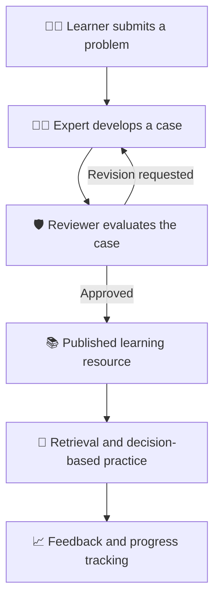

# ⚡ Experience Compression Engine

<p align="center">
  <strong>Compressing Years of Experience Through Technology & Behaviour</strong>
</p>

<p align="center">
  An AI-assisted learning platform that transforms expert knowledge into reviewed cases, practical decision-making, and reusable learning experiences.
</p>

<p align="center">
  <a href="experiance-compression-engine.vercel.app">🌐 Live Demo</a> •
  <a href="https://github.com/shubhamDeyCoder/experiance-compression-engine.git">💻 Repository</a>
</p>

<p align="center">
  
  
  
  
  
</p>

---

## 🌟 The Vision

**What if learners could benefit from years of professional experience without having to learn every lesson the hard way?**

Traditional education teaches concepts, but practical problem-solving also depends on judgment, context, and lessons learned from real situations.

Experience Compression Engine aims to bridge that gap by capturing practitioner experience, validating it through peer review, and turning it into structured learning resources.

## 🚀 Key Features

| Feature | Description |
|---|---|
| 🧑‍💻 Expert Workspace | Create, revise, and submit practical cases for review. |
| 🛡️ Review Workflow | Review cases, provide feedback, and approve learning resources. |
| 🎯 Learner Requests | Submit problems and track their progress toward publication. |
| 🧠 AI-Assisted Retrieval | Find relevant cases and explain their relevance to a new problem. |
| 📝 Decision-Based Practice | Practise scenarios and receive server-evaluated feedback. |
| 📊 Learning Progress | Track practice attempts and learning activity. |
| 🏢 Company Onboarding | Foundation for company workspaces, managers, and employee invitations. |

> 🚧 Development note: Company onboarding is a foundation. The manager dashboard, invitation-management UI, and email delivery still require implementation.

## 🔄 How It Works



## 🧠 What Makes ECE Different?

- **Experience-first learning:** Focuses on practical decisions, not just theoretical explanations.
- **Human-reviewed knowledge:** Expert contributions pass through a review workflow before publication.
- **Explainable retrieval:** Helps learners understand why a case may be relevant.
- **Security by design:** Uses database-level authorization instead of trusting frontend restrictions.
- **Built for growth:** Establishes a foundation for connecting individual expertise with organizational learning.

## 🏗️ Technology Stack

<p align="center">
  
</p>

| Layer | Technology |
|---|---|
| Frontend | Next.js App Router, React, TypeScript |
| Authentication | Supabase Auth |
| Database | PostgreSQL via Supabase |
| Authorization | Row Level Security (RLS) |
| Database operations | PostgreSQL RPC functions |
| AI integration | Optional Anthropic API integration |
| Deployment | Vercel |
| Database migrations | Supabase CLI |

## 🔐 Security Architecture

Security and data integrity are central to the workflow.

- 🔒 Row Level Security restricts access to authorized records.
- 👤 Experts can manage only permitted cases.
- 🛡️ Reviewers access cases awaiting review.
- 📚 Learners access approved resources.
- ⚙️ Database functions validate permissions and workflow transitions.
- 🚫 Authors cannot approve their own submissions.
- 🧾 Submission and review snapshots support traceability.

These guarantees depend on the deployed database policies, grants, migrations, and functions being correctly configured.

## ⚙️ Run Locally

### Prerequisites

- Node.js and npm
- A Supabase project
- Supabase CLI

### 1. Clone the repository

```bash
git clone YOUR_GITHUB_REPOSITORY_URL
cd experience-compression-engine
```

### 2. Install dependencies

```bash
npm install
```

### 3. Configure environment variables

Create `.env.local` in the project root:

```env
NEXT_PUBLIC_SUPABASE_URL=your_supabase_project_url
NEXT_PUBLIC_SUPABASE_PUBLISHABLE_KEY=your_supabase_publishable_key
ANTHROPIC_API_KEY=your_anthropic_api_key
```

The Anthropic API key is optional if the external LLM integration is not being used.

**Never commit `.env.local` or expose secret API keys in frontend code.**

### 4. Apply database migrations

Link your Supabase project, then run:

```bash
supabase login
supabase link --project-ref YOUR_SUPABASE_PROJECT_REF
supabase db push
```

Review pending migrations before applying them to a production database.

### 5. Start the application

```bash
npm run dev
```

Open [http://localhost:3000](http://localhost:3000).

### 6. Verify the production build

```bash
npm run lint
npm run build
```

## ☁️ Deployment

ECE is deployed on Vercel.

1. Connect the GitHub repository to Vercel.
2. Configure the required environment variables in Vercel project settings.
3. Apply the required Supabase migrations.
4. Deploy and inspect the build logs.
5. Test authentication, case submission, review, and published-resource access on the live deployment.

**Live application:** [Open Experience Compression Engine](YOUR_VERCEL_URL)

## 🗺️ Roadmap

- [x] Next.js and Supabase foundation
- [x] Expert case capture and review workflow
- [x] Learner case-request workflow foundation
- [x] Database-backed access control
- [x] Vercel deployment
- [x] Company onboarding foundation
- [ ] Complete manager dashboard and invitation UI
- [ ] Implement invitation email delivery
- [ ] Complete company membership and case-role integration
- [ ] Evaluate retrieval quality against real-world scenarios
- [ ] Improve recommendations using validated expert cases
- [ ] Measure learning outcomes

## 🎬 Project Demo

_Add screenshots or a short GIF here after capturing the actual running application._

Recommended demo sequence:

1. Learner submits a problem.
2. Expert creates and submits a case.
3. Reviewer approves the case.
4. Learner opens the published resource.
5. The learning engine retrieves relevant experience.

## 🎯 Built For

**Indian Engineering Week (IEW) Hackathon 2027**

**Problem Statement:** Experience Compression Engine

**Theme:** Compressing Years of Experience Through Technology & Behaviour

---

<p align="center">
  ⚡ Turning experience into structured knowledge.<br />
  🧠 Turning knowledge into better decisions.
</p>
