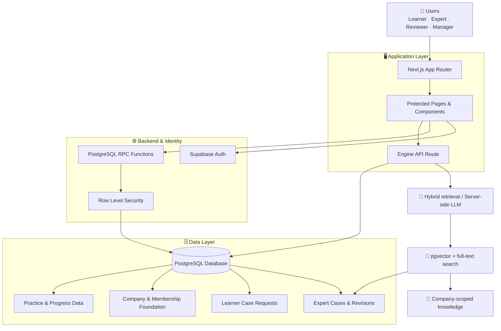
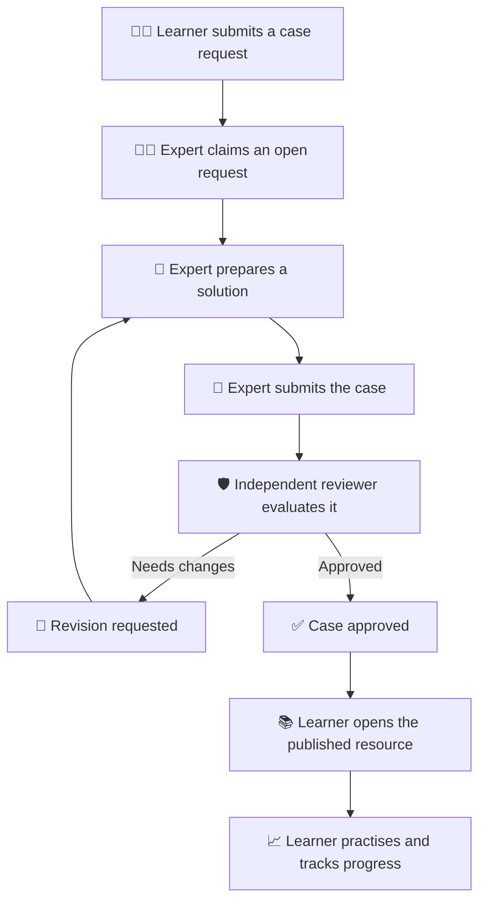
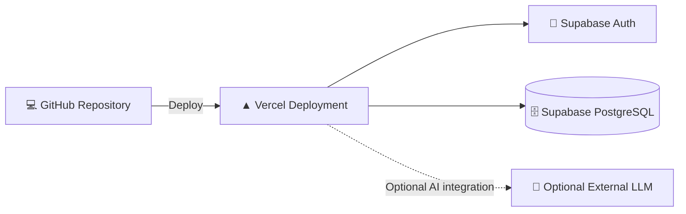

# 🏗️ Experience Compression Engine — System Architecture

## 🌐 Overview

Experience Compression Engine (ECE) is a full-stack learning platform designed to capture practitioner experience, validate it through human review, and make approved knowledge available for scenario-based learning.

The application uses Next.js for the user-facing experience and Supabase for authentication, PostgreSQL data storage, and database-enforced authorization.

The architecture separates user interaction, trusted workflow operations, and data access to reduce reliance on frontend-only security checks.

## 🧭 High-Level Architecture

*Conceptual architecture: verify individual data paths against the current implementation before treating this diagram as a complete implementation specification.*

## 🧩 Core Components

### 1. Frontend — Next.js

The frontend provides the application pages, forms, dashboards, and learning interfaces.

Responsibilities include:

- Rendering learner, expert, and reviewer workspaces.
- Collecting and displaying case information.
- Showing request, review, and publication statuses.
- Presenting practice feedback and progress.
- Providing company onboarding interfaces where implemented.

Protected pages improve the user experience, but they are not a replacement for backend authorization.

### 2. Authentication — Supabase Auth

Supabase Auth manages user authentication and sessions.

Authenticated identities are used by database policies and workflow functions to determine which operations a user may perform.

### 3. Database — PostgreSQL

PostgreSQL stores the platform's structured information, including the applicable case, revision, learner-request, role, and progress data.

The exact tables and relationships are defined by the migrations in `supabase/migrations/`.

### 4. Authorization — RLS and RPC Functions

Row Level Security restricts which database records a user can access.

Database RPC functions perform protected workflow transitions, such as creating drafts, submitting cases, and recording review decisions.

Critical operations must validate the caller's identity, role, input, and permitted state transition on the server side.

### 5. Learning Engine — Hybrid RAG and AI practice

The engine uses PostgreSQL full-text search and, when `OPENAI_API_KEY` is configured, vector embeddings to retrieve approved cases and validated company knowledge. Case results cite the learning resource; web knowledge cites the allow-listed source URL. Company records are filtered by the caller's memberships inside a security-definer search function.

When `ANTHROPIC_API_KEY` is configured, server-side calls generate fictional practice scenarios from retrieved evidence and evaluate learner responses against reviewer-approved case options and reasoning. Learner progress adapts scenario difficulty. Manager decisions and trusted-source excerpts can be added to a company workspace; learner feedback remains pending until a manager validates it.

No provider key is sent to the browser. Company text and learner answers are sent to configured model providers for AI operations. Retrieval and feedback do not update model weights or constitute fine-tuning. Evaluations and validated feedback are stored with provenance for future, separately validated datasets.

The optional `ai-engine/` FastAPI service independently verifies forwarded Supabase user tokens and a private Next.js-to-service shared key. It fetches manager-approved company training data through privileged RPCs, trains per-company TF-IDF/logistic-regression classifiers, evaluates candidates on group-separated holdouts, and promotes only candidates passing configured quality gates. Its active manager-review classifier can return a clearly labeled experimental historical signal to `/engine`; it is not a learner grade. A separate worker periodically checks eligible companies and persists versioned model artifacts. RAG retrieval, adaptive difficulty, and supervised weight updates are separate capabilities.

The launch-hardening migration adds atomic per-user/action quotas for the engine API. Trusted-source requests use DNS lookup, block special-use destinations, pin outbound HTTPS connections to a vetted public IPv4 result, and do not follow redirects. Production still requires hosting-level ingress rate limits and outbound egress restrictions, plus staging verification of database grants and cross-company isolation.

## 🔄 Expert-to-Learner Workflow

## 🔐 Security Principles

- **Identity:** Use authenticated sessions to establish the caller's identity.
- **Least privilege:** Grant only the access required for each role.
- **Database enforcement:** Apply RLS and suitable grants to protected tables and functions.
- **Workflow integrity:** Validate permitted state transitions in trusted database operations.
- **Independent review:** Prevent authors from approving their own cases.
- **Secret management:** Keep privileged credentials on the server and out of public repositories.
- **Traceability:** Preserve relevant submission and review snapshots where implemented.

## ☁️ Deployment Architecture

The frontend is deployed on Vercel, while authentication and database services are provided by Supabase.

Deployment requires correctly configured environment variables, database migrations, authentication URLs, production access policies, and (when enabled) a separately deployed Python service with persistent private artifact storage and a scheduled worker. Set `AI_ENGINE_SERVICE_URL` and the same private `AI_ENGINE_INTERNAL_KEY` on the Next.js and Python services. Keep the Supabase service-role key only in the Python worker/trainer environment.

## 🚧 Current Architectural Boundaries

The manager workspace now supports company membership, invitation management, and company-specific knowledge workflows. Email delivery is not configured; managers share invitation links privately. The case workflow's expert/reviewer `case_roles` and company workspace roles are distinct authorization systems.

AI output quality and retrieval relevance require ongoing evaluation against representative real-world scenarios. Semantic search requires the `vector` PostgreSQL extension and indexed approved cases; case embeddings can be added from the manager workspace in batches.

## 🎯 Design Goal

ECE aims to convert individual practitioner knowledge into structured, reviewed, and reusable learning resources, helping learners develop practical decision-making skills more efficiently.
