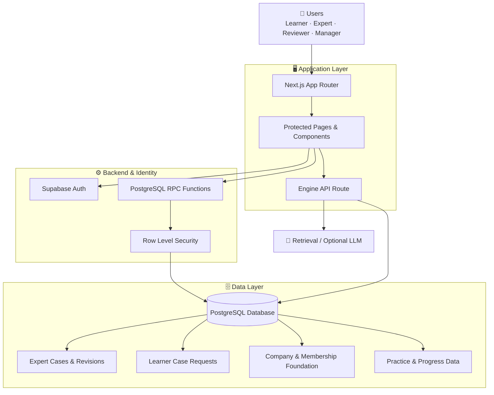
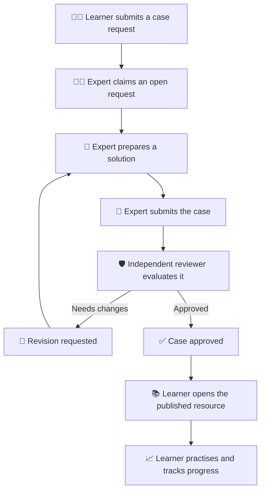
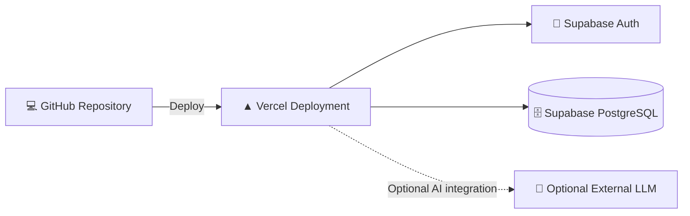

# 🏗️ Experience Compression Engine — System Architecture

## 🌐 Overview

Experience Compression Engine (ECE) is a full-stack learning platform designed to capture practitioner experience, validate it through human review, and make approved knowledge available for scenario-based learning.

The application uses Next.js for the user-facing experience and Supabase for authentication, PostgreSQL data storage, and database-enforced authorization.

The architecture separates user interaction, trusted workflow operations, and data access to reduce reliance on frontend-only security checks.

## 🧭 High-Level Architecture

*Conceptual architecture: verify individual data paths against the current implementation before treating this diagram as a complete implementation specification.*

## 🧩 Core Components

### 1. Frontend — Next.js

The frontend provides the application pages, forms, dashboards, and learning interfaces.

Responsibilities include:

- Rendering learner, expert, and reviewer workspaces.
- Collecting and displaying case information.
- Showing request, review, and publication statuses.
- Presenting practice feedback and progress.
- Providing company onboarding interfaces where implemented.

Protected pages improve the user experience, but they are not a replacement for backend authorization.

### 2. Authentication — Supabase Auth

Supabase Auth manages user authentication and sessions.

Authenticated identities are used by database policies and workflow functions to determine which operations a user may perform.

### 3. Database — PostgreSQL

PostgreSQL stores the platform's structured information, including the applicable case, revision, learner-request, role, and progress data.

The exact tables and relationships are defined by the migrations in `supabase/migrations/`.

### 4. Authorization — RLS and RPC Functions

Row Level Security restricts which database records a user can access.

Database RPC functions perform protected workflow transitions, such as creating drafts, submitting cases, and recording review decisions.

Critical operations must validate the caller's identity, role, input, and permitted state transition on the server side.

### 5. Learning Engine — Retrieval and Optional AI

The learning engine accepts a problem and identifies potentially relevant experience from available cases.

Where configured, an external language model may help generate explanations or other AI-assisted outputs.

Retrieval relevance, model output quality, and limitations must be evaluated rather than assumed.

## 🔄 Expert-to-Learner Workflow

## 🔐 Security Principles

- **Identity:** Use authenticated sessions to establish the caller's identity.
- **Least privilege:** Grant only the access required for each role.
- **Database enforcement:** Apply RLS and suitable grants to protected tables and functions.
- **Workflow integrity:** Validate permitted state transitions in trusted database operations.
- **Independent review:** Prevent authors from approving their own cases.
- **Secret management:** Keep privileged credentials on the server and out of public repositories.
- **Traceability:** Preserve relevant submission and review snapshots where implemented.

## ☁️ Deployment Architecture

The frontend is deployed on Vercel, while authentication and database services are provided by Supabase.

Deployment requires correctly configured environment variables, database migrations, authentication URLs, and production access policies.

## 🚧 Current Architectural Boundaries

The company onboarding foundation does not yet constitute a complete enterprise management system. Manager-facing invitation controls, email delivery, and full company-membership integration remain separate implementation tasks.

The retrieval and AI components also require ongoing evaluation against representative real-world scenarios.

## 🎯 Design Goal

ECE aims to convert individual practitioner knowledge into structured, reviewed, and reusable learning resources, helping learners develop practical decision-making skills more efficiently.
