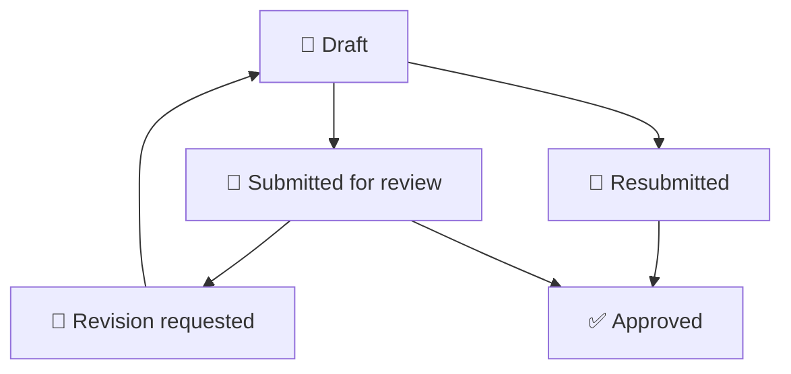

# 🗄️ Experience Compression Engine — Database Design

## 🌐 Overview

Experience Compression Engine (ECE) uses Supabase PostgreSQL to store application data and enforce critical workflow rules.

The database supports expert case creation, independent review, learner case requests, practice activities, and the foundation for company onboarding.

The authoritative schema is defined by the SQL migration files in `supabase/migrations/`.

## 🧱 Core Data Domains

| Domain | Purpose |
|---|---|
| 👤 Authentication | User identities and sessions managed by Supabase Auth |
| 🧑‍💻 Case management | Expert-authored cases and their workflow states |
| 📝 Revision history | Submission and review snapshots for traceability |
| 🎓 Learner requests | Problems submitted by learners for expert assistance |
| 🛡️ Role management | Assignment of expert and reviewer workflow roles |
| 🧠 Practice and progress | Learning attempts, evaluation results, and progress data |
| 🏢 Company onboarding | Company workspaces, memberships, and invitations |
| 🧠 AI learning engine | Company-scoped validated knowledge, embeddings, scenarios, evaluations, and feedback |

The actual tables, relationships, and available fields depend on the migrations applied to the database.

## 🔐 Authentication and Authorization

Supabase Auth authenticates users. Database policies and protected database functions determine which actions each authenticated user may perform.

The `public.case_roles` table supports workflow-role assignments for experts and reviewers.

- **Learner:** Uses normal authentication and accesses permitted learner resources.
- **Expert:** Creates and manages permitted cases and submits work for review.
- **Reviewer:** Reviews submitted cases and approves them or requests revisions.
- **Administrator:** Assigns workflow roles through authorized administrative operations.
- **Company manager:** Part of the company-onboarding direction; complete management permissions depend on the implemented membership integration.

Role names alone do not establish access. Effective permissions also depend on database grants, RLS policies, function checks, and the current user's identity.

## 🔄 Case Workflow



This is a conceptual illustration of the case lifecycle. Refer to the database functions and migration constraints for the exact allowed transitions.

## 🛡️ Row Level Security

Row Level Security (RLS) is used to restrict access to protected records according to the authenticated caller and applicable authorization rules.

Important security requirements include:

- Users must not be able to read or modify unauthorized records.
- Experts must not modify another expert's protected work.
- Reviewers must not approve their own submissions.
- Learners must not access pending or private expert cases through unauthorized paths.
- Company membership and invitation operations must validate the caller's permissions.
- Sensitive workflow transitions must be performed through appropriately protected database functions.

RLS policies should be tested independently of frontend route protection.

## ⚙️ Database Functions

Protected PostgreSQL RPC functions can perform operations that require validation and controlled state transitions.

Examples include:

- Creating and updating permitted drafts.
- Submitting cases for review.
- Recording reviewer decisions and feedback.
- Managing learner case requests.
- Creating company workspaces and handling invitations.

Each function must have appropriate execution privileges, input validation, and authorization checks. Security-definer functions require particular care because they may execute with elevated privileges.

## 🧾 Revision Snapshots and Integrity

The `expert_case_revisions` table is used by the case workflow to retain submission and review snapshots.

Snapshots support traceability by preserving relevant information associated with workflow events.

Additional integrity controls include:

- Required-field validation.
- Payload-size and field-length limits.
- Restrictions on editing cases during review.
- Prevention of unauthorized workflow transitions.

## 🏢 Company Onboarding

The company-onboarding foundation introduces:

- `companies` — company workspace records.
- `company_memberships` — company-user membership records.
- `company_invitations` — invitation records.

The manager dashboard uses protected functions for membership overview and invitation creation/acceptance. Invitation email delivery is not configured. Company workspace roles coexist with the expert/reviewer `case_roles` workflow; verify both role systems when testing access.

## 🧠 AI learning data and isolation

The `20261025120000_ai_learning_engine.sql` migration adds:

- `engine_knowledge`: manager decisions, allow-listed web source content, and manager-validated feedback; each row belongs to one company and stores a 1536-dimension embedding.
- `expert_cases.engine_embedding`: optional embeddings for reviewer-approved shared cases.
- `engine_scenarios`, `engine_evaluations`, and `engine_feedback`: learner-owned scenario/evaluation records and feedback, with company attribution where available.
- `engine_evaluation_examples`: company-scoped evaluation candidates that remain pending until a manager validates or rejects them for a future evaluation dataset. Managers can export only validated examples and feedback through a company-scoped RPC.
- `engine_trusted_domains`: platform-admin-managed allow-list for web ingestion.
- `export_engine_training_dataset`: returns manager-authorized, company-scoped expert-reviewed evaluation decisions, company learner attempts against approved expert-authored rubrics, and curated company knowledge. Interactive callers can export only their own manager company; the service-role worker must explicitly provide a valid company ID.
- `list_engine_training_companies`: service-role-only discovery of companies with reviewed training examples or learner attempts, for scheduled retraining.
- `engine_request_limits` and `consume_engine_request_limit`: private per-user/action request counters updated atomically by an allow-listed RPC. The table has RLS enabled and no direct client grants; API calls fail closed if quota checks fail.

Direct browser access to these tables is revoked. Protected security-definer functions enforce identity, company membership, manager/reviewer privileges, learner ownership, and approved-case status. Hybrid retrieval includes the caller's primary company knowledge only; approved platform cases remain shared learning content. The existing case approval and practice-scoring functions remain authoritative.

To authorize an external source domain, an administrator must review and insert its base domain into `public.engine_trusted_domains`. The manager ingestion endpoint accepts HTTPS only, refuses redirects, and caps downloaded pages at 1 MB. RAG retrieval, validated feedback, and stored evaluations are not model training or fine-tuning.

When enabled, the Python training process accesses data only through the export RPC, maintains separate company artifact directories, and requires minimum class counts and a leakage-resistant group holdout before promoting a model. The Supabase service-role key is server-only and must never be placed in Next.js public environment variables or browser code.

## 🚀 Migrations and Local Development

Database changes are maintained in `supabase/migrations/`.

To apply reviewed migrations to a linked development project:

```bash
supabase login
supabase link --project-ref YOUR_SUPABASE_PROJECT_REF
supabase db push
```

Review migration contents and the target database before applying changes. Avoid using production data for routine testing.

## 🧪 Recommended Database Tests

- [ ] Verify RLS on all tables containing protected data.
- [ ] Check grants for tables, sequences, and RPC functions.
- [ ] Test requests made by unauthenticated users.
- [ ] Test access across different user accounts and roles.
- [ ] Confirm authors cannot approve their own cases.
- [ ] Confirm learners cannot read unpublished cases.
- [ ] Validate case payloads and invalid state transitions.
- [ ] Test company membership and invitation authorization.
- [ ] Confirm migrations work against a clean development database.

## 📌 Source of Truth

This document describes the database design at a conceptual level. For exact columns, constraints, relationships, policies, and function definitions, consult the SQL migrations and the live database schema.

Keep this document updated whenever the schema or authorization model changes.
